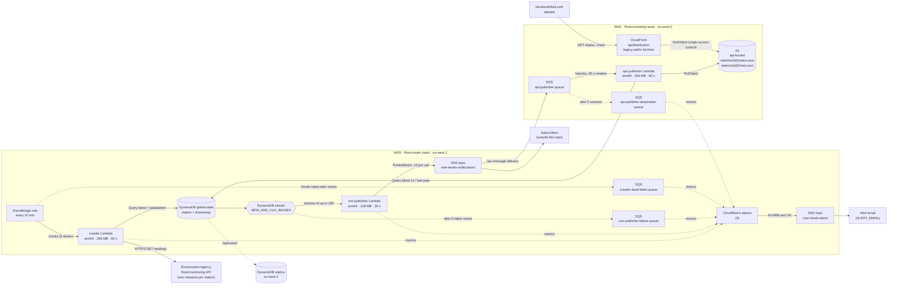
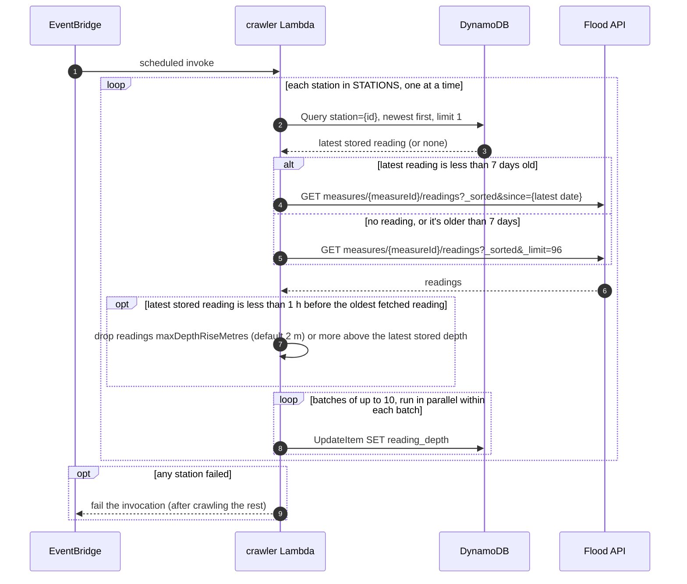
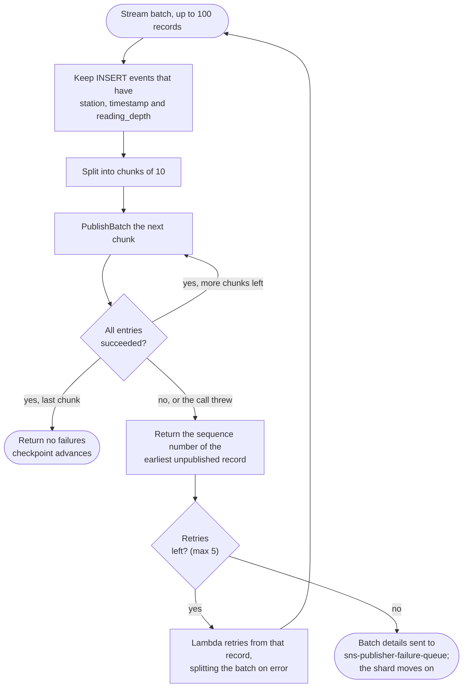
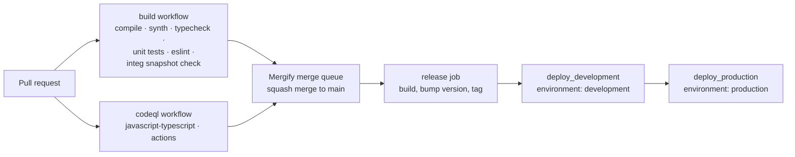

# Infrastructure

This page describes what the CDK app deploys and how data moves through it. The source of truth is the code in [`src/`](../src). If you change the infrastructure, update this page in the same PR.

- **App entry point:** [`src/main.ts`](../src/main.ts)
- **Stacks:** two, both deployed by `cdk deploy --all`:
  - `RiverLevels` ([`StorageStack`](../src/storage-stack/index.ts)): the crawler, the readings table and the new-reading notifications
  - `RiverLevelsApi` ([`ApiStack`](../src/api-stack/index.ts)): publishes each station's status and chart as JSON files in S3. It imports the readings table, the notifications topic and the alerts topic from `RiverLevels`, so those can't be renamed or replaced while it uses them.
- **Primary region:** `eu-west-2` (London), with a DynamoDB replica in `eu-west-1` (Ireland)
- **Environments:** `development` and `production`, deployed by GitHub Actions to separate AWS accounts

## Architecture



Each stack also creates a CloudWatch log group per Lambda (one-year retention) and one IAM role per Lambda. X-Ray tracing is on for all three Lambdas and the notifications topic.

## How a reading gets from the API to a subscriber

### 1. Crawl: every 10 minutes

[`crawler.lambda.ts`](../src/storage-stack/crawler.lambda.ts) decides how much to fetch, based on the latest reading already stored.



#### Stations

The crawler's stations are listed in [`src/storage-stack/stations.ts`](../src/storage-stack/stations.ts) and passed to it as the `STATIONS` environment variable (JSON). Each station has:

- `id`: the `station` key in the table and in SNS messages. Keep existing IDs stable, because changing one starts a new series.
- `measureId`: the Environment Agency flood-monitoring measure, for example `2627-level-stage-i-15_min-mASD` for Kenilworth.
- `maxDepthRiseMetres` (optional): the spike filter threshold, 2 m by default.

The list is validated at synth time: it must not be empty, IDs must be unique, and thresholds must be positive. Only `kenilworth` is configured today. To add a station, add an entry and deploy. Its first run backfills the last 96 readings.

Stations are crawled one at a time in a single invocation. If one fails, the error is logged with its station ID, the others still run, and the invocation then fails, so the `crawler-errors` alarm fires. Every station shares the crawler's 60-second timeout, so a long list may need a higher timeout.

The thresholds are named constants at the top of `crawler.lambda.ts`: `DEFAULT_READINGS_LIMIT` (96), `MAX_LOOKBACK_DAYS` (7), `SPIKE_FILTER_WINDOW_MS` (1 hour) and `DEFAULT_MAX_DEPTH_RISE_METRES` (2, overridable per station). The spike filter only applies when the new readings follow on from the stored one without a gap, so a real rise after an outage isn't thrown away. The crawler logs a warning when it drops readings.

`UpdateItem` creates or overwrites a reading. A new key produces an `INSERT` stream event. Writing an existing key again produces a `MODIFY` event, which the publisher ignores. So re-fetching readings that are already stored doesn't send duplicate notifications.

### 2. Publish: on every stream batch

[`sns-publisher.lambda.ts`](../src/storage-stack/sns-publisher.lambda.ts) turns `INSERT` events into SNS messages:

```json
{"reading_depth": 0.694, "station": "kenilworth", "timestamp": 1718374500000}
```

`timestamp` is in epoch milliseconds and `reading_depth` is in metres. Subscribers depend on this format, so changes to it must be backward compatible.



The failure queue holds stream positions (shard and sequence numbers), not the readings themselves. To recover a batch, read its records from the table or the stream while they're still available. Stream records expire after 24 hours.

### 3. Publish station files: on every batch of new readings

The `RiverLevelsApi` stack keeps a status file and a chart file for each station in S3. These replace the original flood-readings service's `/status` and `/chart` API, in the same JSON shapes, for the kenilworthford.com website.

- `api-publisher-queue` is subscribed to `river-levels-notifications` with raw message delivery, so each message is the SNS message body.
- [`api-publisher.lambda.ts`](../src/api-stack/api-publisher.lambda.ts) reads the queue in batches of up to 100, waiting up to 60 seconds to fill one. It groups messages by station and rebuilds each station's files **once per batch**, so a crawler backfill doesn't rebuild them dozens of times.
- For each station it writes:
  - `stations/{id}/status.json`: worked out by [`status.ts`](../src/api-stack/status.ts) from the latest 12 readings (3 hours), for example `{"depth":1.3,"direction":"rising","rate":"fast","state":"flooded","lastUpdate":"2020-01-01T15:15:00.000Z"}`.
    - `direction` compares the latest depth with the mean of the 12, to 2 decimal places.
    - `rate` comes from their standard deviation: 0.01 m or less is `slow`, up to 0.03 m is `moderate`, more is `fast`, and `none` when the direction is `none`.
    - `state` is only there for stations with a `ford` in `stations.ts`: `clear` up to `floodedAboveMetres`, `flooded` up to `impassableAboveMetres`, then `impassable`. Kenilworth's thresholds are 1.23 m and 1.4 m.
    - The logic is ported from flood-readings and was checked against its `mathjs` implementation.
  - `stations/{id}/chart.json`: every reading from the last 365 days as `[[timestamp, depth], ...]`, oldest first.
- Both files are written with `Content-Type: application/json` and `Cache-Control: max-age=300`.
- If a station fails, only its messages are reported back for retry, and the other stations are still published. After 5 receives a message goes to `api-publisher-dead-letter-queue`, which raises the `api-publisher-dead-letters` alarm. Messages for stations that aren't configured are ignored.

### 4. Serve station files: CloudFront

The `api/distribution` CloudFront distribution serves the bucket, which stays private: CloudFront reads it through origin access control, and the bucket policy only allows CloudFront to `GetObject`.

- **Paths:** the `legacy-paths` CloudFront Function (viewer request) maps the original flood-readings API's paths to the `legacyStationId` station, `kenilworth`:
  - `/status` serves `stations/kenilworth/status.json`
  - `/chart` serves `stations/kenilworth/chart.json`

  Every other path is passed through, so `/stations/{id}/status.json` and `chart.json` serve any station. A missing file returns `403`, because CloudFront can't list the bucket.
- **CORS:** the managed `SimpleCORS` response headers policy adds `Access-Control-Allow-Origin: *` when a request has an `Origin` header, as the original API did.
- **Caching:** the managed `CachingOptimized` policy honours the files' `Cache-Control: max-age=300`, so CloudFront and browsers cache for 5 minutes. Responses are compressed.
- **Delivery:** HTTPS only (HTTP redirects), HTTP/2 and HTTP/3, price class 100 (North America and Europe).
- **Domain:** for now, only its `*.cloudfront.net` domain, output as `ApiDomainName`. `api.kenilworthford.com` and `api.dev.kenilworthford.com` will follow, with their own hosted zones and certificate. The minimum TLS version will be set to 1.2 then.

## Resources

Logical names as they appear in the CloudFormation template.

| Resource | Type | Key settings |
|----------|------|--------------|
| `river-levels-table` | `AWS::DynamoDB::GlobalTable` | Partition key `station` (S), sort key `timestamp` (N). On-demand billing. Point-in-time recovery for 35 days. Deletion protection on. Stream `NEW_AND_OLD_IMAGES`. Replica in each of `replicaRegions` (`eu-west-1`). |
| `crawler-lambda` | `AWS::Lambda::Function` | Node.js 24, arm64, 256 MB, 60 s timeout, X-Ray active. Env: `DYNAMODB_READINGS_TABLE`, `STATIONS` (JSON station list). |
| `crawler-cron` | `AWS::Events::Rule` | `rate(10 minutes)`, 3 retry attempts, then `crawler-dead-letter-queue`. |
| `crawler-dead-letter-queue` | `AWS::SQS::Queue` | 14-day retention, SSL enforced. Receives scheduled invocations EventBridge couldn't deliver to the crawler. |
| `sns-publisher-lambda` | `AWS::Lambda::Function` | Node.js 24, arm64, 128 MB, 30 s timeout, X-Ray active. Env: `SNS_TOPIC_ARN`. |
| `sns-publisher-lambda` event source | `AWS::Lambda::EventSourceMapping` | DynamoDB stream, starting position `LATEST`, batch size 100. `ReportBatchItemFailures` and bisect on error. 5 retries, then on-failure destination. |
| `sns-publisher-failure-queue` | `AWS::SQS::Queue` | 14-day retention, SSL enforced. Receives stream batches that still fail after retries. |
| `alarms/alerts` | `AWS::SNS::Topic` | `river-levels-alerts`. SSL enforced; not encrypted, because CloudWatch can't publish to a topic using the AWS-managed SNS key. Email subscription to `alertEmail` when set. |
| `alarms/*` | `AWS::CloudWatch::Alarm` | Five alarms, listed under [Alarms](#alarms). Each notifies the alerts topic on ALARM and on return to OK. |
| `river-levels-notifications` | `AWS::SNS::Topic` | Encrypted with the AWS-managed `alias/aws/sns` key. SSL enforced. X-Ray active. |
| `crawler-log-group`, `sns-publisher-group` | `AWS::Logs::LogGroup` | One-year retention. |

`RiverLevelsApi` stack:

| Resource | Type | Key settings |
|----------|------|--------------|
| `api-bucket` | `AWS::S3::Bucket` | Private (all public access blocked), S3-managed encryption, SSL enforced, versioned, old versions expire after 14 days. Retained when the stack is deleted. The bucket policy lets only the distribution read it. |
| `api/distribution` | `AWS::CloudFront::Distribution` | Origin: `api-bucket` through origin access control. Managed `CachingOptimized` cache policy and `SimpleCORS` response headers policy. HTTPS only, HTTP/2 and 3, compression, price class 100. |
| `api/legacy-paths` | `AWS::CloudFront::Function` | `cloudfront-js-2.0`, viewer request. Maps `/status` and `/chart` to the legacy station's files. |
| `api-publisher-queue` | `AWS::SQS::Queue` | Subscribed to `river-levels-notifications` with raw message delivery. 6-minute visibility timeout. Redrives to `api-publisher-dead-letter-queue` after 5 receives. |
| `api-publisher-dead-letter-queue` | `AWS::SQS::Queue` | 14-day retention, SSL enforced. |
| `api-publisher-lambda` | `AWS::Lambda::Function` | Node.js 24, arm64, 256 MB, 60 s timeout, X-Ray active. Env: `API_BUCKET`, `DYNAMODB_READINGS_TABLE`, `STATIONS`. |
| `api-publisher-lambda` event source | `AWS::Lambda::EventSourceMapping` | `api-publisher-queue`, batch size 100, 60 s batching window, `ReportBatchItemFailures`. |
| `api-publisher-dead-letters` | `AWS::CloudWatch::Alarm` | See [Alarms](#alarms). |
| `api-publisher-log-group` | `AWS::Logs::LogGroup` | One-year retention. |

**Stack outputs:** `RiverLevelsTable` (the table ARN) from `RiverLevels`, and `ApiBucket` (the bucket name) and `ApiDomainName` (the distribution's domain) from `RiverLevelsApi`.

**Tags** on every resource: `endor:ManagedBy=cdk`, `endor:Stage` (from the `STAGE` env var: `development`, `production`, or `local` when unset), and `endor:Version` (the release tag, or `local`).

## IAM

Each Lambda has its own role under the `/service-role/` path. Both roles attach `AWSLambdaBasicExecutionRole`. CDK also adds a default policy to each role for X-Ray (because tracing is active) and, on the publisher, for its event source. Lambda Insights is not used; it was removed because of its CloudWatch cost.

| Role | Permission | Resource |
|------|------------|----------|
| `crawler-role` | `dynamodb:Query`, `dynamodb:UpdateItem` | the table |
| `sns-publisher-role` | `dynamodb:DescribeStream`, `GetRecords`, `GetShardIterator`, `ListStreams` | the table stream |
| `sns-publisher-role` | `sns:Publish` | the topic |
| `sns-publisher-role` | `sqs:SendMessage`, `GetQueueAttributes`, `GetQueueUrl` (added by CDK) | the failure queue |
| `api-publisher-role` | `dynamodb:Query` | the table |
| `api-publisher-role` | `s3:PutObject` | `stations/*` in `api-bucket` |
| `api-publisher-role` | `sqs:ReceiveMessage`, `DeleteMessage`, `ChangeMessageVisibility`, `GetQueueAttributes`, `GetQueueUrl` (added by CDK) | `api-publisher-queue` |

## Deployment



- The deploy jobs check out the released commit and download the release job's `dist` artifact, which provides `releasetag.txt` for the `endor:Version` tag. They don't rebuild or re-run tests: the release job already did that for the same commit, and `cdk deploy` bundles the Lambdas through the `build` hook in `cdk.json`.
- Both deploy jobs run `yarn deploy --require-approval never` in `eu-west-2`, which runs `cdk deploy --all` and so deploys both stacks, with `STAGE` set to `development` or `production` for the `endor:Stage` tag.
- Both jobs also pass `ALERT_EMAIL` from the `ALERT_EMAIL` GitHub secret (a repository secret, or an environment secret to use a different address per environment). The synth fails if it is missing for a deployed stage. AWS emails a confirmation link after the first deploy, and alerts aren't delivered until it is clicked.
- Each job signs in to AWS through GitHub OIDC with the role in that environment's `AWS_DEPLOYMENT_ROLE_ARN` secret. Approval rules or required reviewers on the `production` environment are configured in GitHub, not in this repo.
- Pull requests are merged only by the Mergify queue, once `build` and `CodeQL` pass. PRs from `trustedAuthors` (the sole maintainer) need no approval; everyone else's need one, and fork PRs also need their workflow runs approved first. Draft PRs and PRs labelled `do-not-merge` are held. The repository settings are described in [`docs/github-configuration.md`](github-configuration.md), which projen generates.
- The deploy jobs come from the `deployments` option in `.projenrc.ts`, which projen-modules turns into jobs on the release workflow.
- The workflow is generated from [`.projenrc.ts`](../.projenrc.ts). Change it there, not in `.github/workflows/`.
- The integ snapshot check compares the synthesized templates with the committed snapshots in `test/storage-stack/` and `test/api-stack/`. Any change to the template needs `yarn integ:update`, which deploys a temporary stack to AWS and runs end-to-end assertions.

## Operations

- **Logs:** CloudWatch Logs groups for `crawler-lambda` and `sns-publisher-lambda`. The crawler writes structured JSON through Powertools Logger (service `crawler`), including the Lambda request ID, so it can be queried with CloudWatch Logs Insights. It logs counts and date ranges, not whole payloads.
- **Traces:** X-Ray. The crawler records subsegments for the latest-reading lookup, the API fetch and the database writes, and traces each DynamoDB call and the HTTPS request to the flood API.
- **Failed notifications:** messages arriving in `sns-publisher-failure-queue`.
- **Failed station files:** messages arriving in `api-publisher-dead-letter-queue`. The publisher logs through Powertools Logger as service `api-publisher`.
- **Restore:** use DynamoDB point-in-time recovery, available for the last 35 days.

### Alarms

The storage alarms are in [`src/storage-stack/alarms.ts`](../src/storage-stack/alarms.ts) and the API publisher's in [`src/api-stack/index.ts`](../src/api-stack/index.ts). All of them email `ALERT_EMAIL` through the `river-levels-alerts` topic, both when they fire and when they recover.

| Alarm | Fires when | Where to look |
|-------|-----------|---------------|
| `crawler-errors` | The crawler reports errors in every 10-minute window for 30 minutes. One bad run (up to 3 errors with Lambda's async retries) doesn't trigger it. | Crawler logs; the flood API's availability |
| `crawler-not-running` | No crawler invocations in 30 minutes. Missing data counts as breaching. | The `crawler-cron` rule is enabled; `crawler-dead-letter-queue` |
| `crawler-dead-letters` | `crawler-dead-letter-queue` has any messages | EventBridge couldn't invoke the crawler; check its permissions and throttling |
| `sns-publisher-iterator-age` | The publisher is 15 minutes or more behind the stream for 10 minutes | Publisher logs; SNS errors or throttling |
| `sns-publisher-failures` | `sns-publisher-failure-queue` has any messages | The queued stream positions; recover readings from the table |
| `api-publisher-dead-letters` | `api-publisher-dead-letter-queue` has any messages | Publisher logs (service `api-publisher`); DynamoDB or S3 errors |
