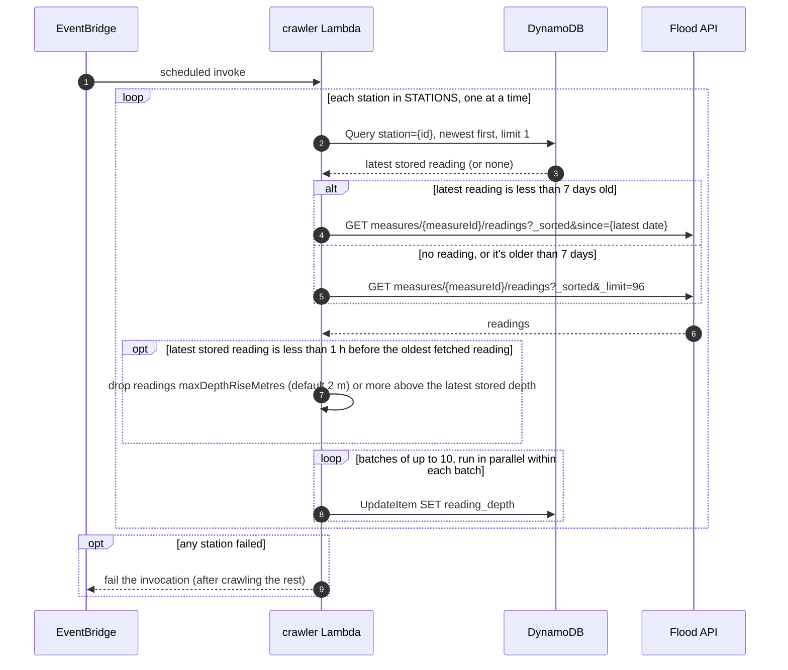
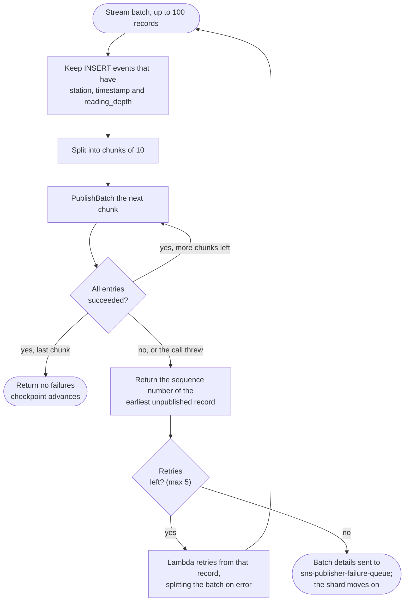
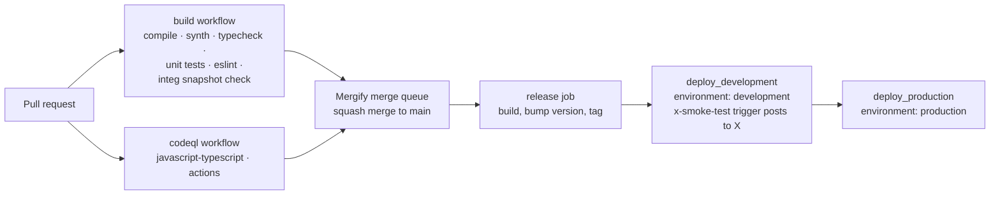

# Infrastructure

This page describes what the CDK app deploys and how data moves through it. The source of truth is the code in [`src/`](../src). If you change the infrastructure, update this page in the same PR.

- **App entry point:** [`src/main.ts`](../src/main.ts)
- **Stacks:** four, all deployed by `cdk deploy --all`:
  - `RiverLevels` ([`StorageStack`](../src/storage-stack/index.ts)): the crawler, the readings table and the new-reading notifications
  - `RiverLevelsApi` ([`ApiStack`](../src/api-stack/index.ts)): publishes each station's status and chart as JSON files in S3. It imports the readings table, the notifications topic and the alerts topic from `RiverLevels`, so those can't be renamed or replaced while it uses them.
  - `RiverLevelsApiDomain` ([`ApiDomainStack`](../src/api-domain-stack/index.ts)), in **`us-east-1`**: the hosted zone for the API's domain. It's in us-east-1 because the CloudFront certificate validated against it has to be, and keeping zone and certificate in one stack avoids the stacks depending on each other.
  - `RiverLevelsNotifications` ([`NotificationsStack`](../src/notifications-stack/index.ts)): posts ford state changes to X. It imports the `station-status` topic from `RiverLevelsApi` and the alerts topic from `RiverLevels`.
- **Primary region:** `eu-west-2` (London), with a DynamoDB replica in `eu-west-1` (Ireland)
- **Environments:** `development` and `production`, deployed by GitHub Actions to separate AWS accounts

## Architecture

```mermaid
flowchart LR
  ea["Environment Agency<br/>flood-monitoring API<br/>(one measure per station)"]

  subgraph aws["AWS · RiverLevels stack · eu-west-2"]
    direction LR
    rule["EventBridge rule<br/>every 10 min"]
    crawler["crawler Lambda<br/>arm64 · 256 MB · 60 s"]
    table[("DynamoDB global table<br/>station + timestamp")]
    stream{{"DynamoDB stream<br/>NEW_AND_OLD_IMAGES"}}
    publisher["sns-publisher Lambda<br/>arm64 · 128 MB · 30 s"]
    topic["SNS topic<br/>river-levels-notifications"]
    dlq["SQS<br/>sns-publisher-failure-queue"]
    crawlerdlq["SQS<br/>crawler-dead-letter-queue"]
    alarms["CloudWatch alarms<br/>(5)"]
    alerts["SNS topic<br/>river-levels-alerts"]
  end

  subgraph api["AWS · RiverLevelsApi stack · eu-west-2"]
    direction LR
    apiqueue["SQS<br/>api-publisher-queue"]
    apidlq["SQS<br/>api-publisher-dead-letter-queue"]
    apipublisher["api-publisher Lambda<br/>arm64 · 256 MB · 60 s"]
    bucket[("S3<br/>api-bucket<br/>stations/{id}/status.json<br/>stations/{id}/chart.json")]
    cdn["CloudFront<br/>api/distribution<br/>legacy-paths function"]
    statustopic["SNS topic<br/>station-status"]
  end

  subgraph notifications["AWS · RiverLevelsNotifications stack · eu-west-2"]
    direction LR
    xqueue["SQS<br/>x-notifier-queue"]
    xdlq["SQS<br/>x-notifier-dead-letter-queue"]
    xnotifier["x-notifier Lambda<br/>arm64 · 256 MB · 30 s"]
    xstate[("DynamoDB<br/>x-notifier-state")]
    xsecret["Secrets Manager<br/>x-credentials"]
    xsmoke["x-smoke-test Lambda + trigger<br/>(development only)"]
  end

  xaccount["X account"]

  subgraph domain["AWS · RiverLevelsApiDomain stack · us-east-1"]
    zone["Route 53 hosted zone<br/>api-zone<br/>api.kenilworthford.com"]
    cert["ACM certificate<br/>api-certificate<br/>(when the stage's custom domain is on)"]
  end

  parentzone["kenilworthford.com zone<br/>(endor-infrastructure)"]

  replica[("DynamoDB replica<br/>eu-west-1")]
  subs["Subscribers<br/>(outside this repo)"]
  email["Alert email<br/>(ALERT_EMAIL)"]
  website["kenilworthford.com<br/>website"]

  rule -- "invoke (3 retries)" --> crawler
  rule -. "invoke failed after retries" .-> crawlerdlq
  crawler -- "HTTPS GET readings" --> ea
  crawler -- "Query latest / UpdateItem" --> table
  table -. "replication" .-> replica
  table --> stream
  stream -- "batches of up to 100" --> publisher
  publisher -- "PublishBatch, 10 per call" --> topic
  stream -. "after 5 failed retries" .-> dlq
  topic --> subs
  topic -- "raw message delivery" --> apiqueue
  apiqueue -- "batches, 60 s window" --> apipublisher
  apiqueue -. "after 5 receives" .-> apidlq
  apipublisher -- "Query latest 12 / last year" --> table
  apipublisher -- "PutObject" --> bucket
  apipublisher -- "each station's status, every batch" --> statustopic
  statustopic -- "raw message delivery" --> xqueue
  xqueue -- "batches of 10" --> xnotifier
  xqueue -. "after 5 receives" .-> xdlq
  xnotifier -- "last posted state" --> xstate
  xnotifier -- "credentials" --> xsecret
  xnotifier -- "post on a state change (post mode)" --> xaccount
  xsmoke -- "credentials" --> xsecret
  xsmoke -. "post and delete on each deploy" .-> xaccount
  xdlq -. "metrics" .-> alarms
  cdn -- "GetObject (origin access control)" --> bucket
  website -- "GET /status, /chart" --> cdn
  parentzone -. "NS delegation (to do)" .-> zone
  cert -. "validated in" .-> zone
  cdn -. "custom domain, TLS 1.2 (when on)" .-> cert
  zone -. "alias A/AAAA (when on)" .-> cdn
  apidlq -. "metrics" .-> alarms
  crawler & publisher & dlq & crawlerdlq -. "metrics" .-> alarms
  alarms -- "ALARM and OK" --> alerts
  alerts --> email
```



Each stack also creates a CloudWatch log group per Lambda (one-year retention) and one IAM role per Lambda. X-Ray tracing is on for all three Lambdas and the notifications topic.

## How a reading gets from the API to a subscriber

### 1. Crawl: every 10 minutes

[`crawler.lambda.ts`](../src/storage-stack/crawler.lambda.ts) decides how much to fetch, based on the latest reading already stored.



#### Stations

The crawler's stations are listed in [`src/storage-stack/stations.ts`](../src/storage-stack/stations.ts) and passed to it as the `STATIONS` environment variable (JSON). Each station has:

- `id`: the `station` key in the table and in SNS messages. Keep existing IDs stable, because changing one starts a new series.
- `measureId`: the Environment Agency flood-monitoring measure, for example `2627-level-stage-i-15_min-mASD` for Kenilworth.
- `maxDepthRiseMetres` (optional): the spike filter threshold, 2 m by default.

The list is validated at synth time: it must not be empty, IDs must be unique, and thresholds must be positive. Only `kenilworth` is configured today. To add a station, add an entry and deploy. Its first run backfills the last 96 readings.

Stations are crawled one at a time in a single invocation. If one fails, the error is logged with its station ID, the others still run, and the invocation then fails, so the `crawler-errors` alarm fires. Every station shares the crawler's 60-second timeout, so a long list may need a higher timeout.

The thresholds are named constants at the top of `crawler.lambda.ts`: `DEFAULT_READINGS_LIMIT` (96), `MAX_LOOKBACK_DAYS` (7), `SPIKE_FILTER_WINDOW_MS` (1 hour) and `DEFAULT_MAX_DEPTH_RISE_METRES` (2, overridable per station). The spike filter only applies when the new readings follow on from the stored one without a gap, so a real rise after an outage isn't thrown away. The crawler logs a warning when it drops readings.

`UpdateItem` creates or overwrites a reading. A new key produces an `INSERT` stream event. Writing an existing key again produces a `MODIFY` event, which the publisher ignores. So re-fetching readings that are already stored doesn't send duplicate notifications.

### 2. Publish: on every stream batch

[`sns-publisher.lambda.ts`](../src/storage-stack/sns-publisher.lambda.ts) turns `INSERT` events into SNS messages:

```json
{"reading_depth": 0.694, "station": "kenilworth", "timestamp": 1718374500000}
```

`timestamp` is in epoch milliseconds and `reading_depth` is in metres. Subscribers depend on this format, so changes to it must be backward compatible.



The failure queue holds stream positions (shard and sequence numbers), not the readings themselves. To recover a batch, read its records from the table or the stream while they're still available. Stream records expire after 24 hours.

### 3. Publish station files: on every batch of new readings

The `RiverLevelsApi` stack keeps a status file and a chart file for each station in S3. These replace the original flood-readings service's `/status` and `/chart` API, in the same JSON shapes, for the kenilworthford.com website.

- `api-publisher-queue` is subscribed to `river-levels-notifications` with raw message delivery, so each message is the SNS message body.
- [`api-publisher.lambda.ts`](../src/api-stack/api-publisher.lambda.ts) reads the queue in batches of up to 100, waiting up to 60 seconds to fill one. It groups messages by station and rebuilds each station's files **once per batch**, so a crawler backfill doesn't rebuild them dozens of times.
- For each station it writes:
  - `stations/{id}/status.json`: worked out by [`status.ts`](../src/api-stack/status.ts) from the latest 12 readings (3 hours), for example `{"depth":1.3,"direction":"rising","rate":"fast","state":"flooded","lastUpdate":"2020-01-01T15:15:00.000Z"}`.
    - `direction` compares the latest depth with the mean of the 12, to 2 decimal places.
    - `rate` comes from their standard deviation: 0.01 m or less is `slow`, up to 0.03 m is `moderate`, more is `fast`, and `none` when the direction is `none`.
    - `state` is only there for stations with a `ford` in `stations.ts`: `clear` up to `floodedAboveMetres`, `flooded` up to `impassableAboveMetres`, then `impassable`. Kenilworth's thresholds are 1.23 m and 1.4 m.
    - The logic is ported from flood-readings and was checked against its `mathjs` implementation.
  - `stations/{id}/chart.json`: every reading from the last 365 days as `[[timestamp, depth], ...]`, oldest first.
- Both files are written with `Content-Type: application/json` and `Cache-Control: max-age=300`.
- If a station fails, only its messages are reported back for retry, and the other stations are still published. After 5 receives a message goes to `api-publisher-dead-letter-queue`, which raises the `api-publisher-dead-letters` alarm. Messages for stations that aren't configured are ignored.

### 4. Serve station files: CloudFront

The `api/distribution` CloudFront distribution serves the bucket, which stays private: CloudFront reads it through origin access control, and the bucket policy only allows CloudFront to `GetObject`.

- **Paths:** the `legacy-paths` CloudFront Function (viewer request) maps the original flood-readings API's paths to the `legacyStationId` station, `kenilworth`:
  - `/status` serves `stations/kenilworth/status.json`
  - `/chart` serves `stations/kenilworth/chart.json`

  Every other path is passed through, so `/stations/{id}/status.json` and `chart.json` serve any station. A missing file returns `403`, because CloudFront can't list the bucket.
- **CORS:** a custom response headers policy (`api/cors`) adds `Access-Control-Allow-Origin: *` for any origin, allowing any request header, `GET`/`HEAD`/`OPTIONS`, and overriding the origin's headers. That matches the original API, which sent it on every response. The managed `SimpleCORS` policy was replaced because it allows no request headers: CloudFront then left CORS headers off requests carrying headers Chrome adds itself, such as `cache-control` and `pragma` on a reload.
- **Caching:** the managed `CachingOptimized` policy honours the files' `Cache-Control: max-age=300`, so CloudFront and browsers cache for 5 minutes. Responses are compressed.
- **Delivery:** HTTPS only (HTTP redirects), HTTP/2 and HTTP/3, price class 100 (North America and Europe).
- **Domain:** always its `*.cloudfront.net` domain, output as `ApiDomainName`. A stage whose custom domain is on also serves at its API domain, with a TLS 1.2 minimum; see [API domains](#api-domains).

### 5. Notifications: posting ford state changes to X

After writing a station's `status.json`, the API publisher also publishes the status to the `station-status` SNS topic, once per batch, whether or not anything changed:

```json
{"station":"kenilworth","depth":1.3,"direction":"rising","rate":"fast","state":"flooded","lastUpdate":"2020-01-01T15:15:00.000Z"}
```

The `RiverLevelsNotifications` stack's [`x-notifier`](../src/notifications-stack/x-notifier.lambda.ts) reads them through `x-notifier-queue`. For each station in a batch, it takes the newest status and compares its ford `state` with the last state posted, which is kept in the `x-notifier-state` table ([`decide.ts`](../src/notifications-stack/decide.ts)):

- **Nothing recorded yet:** records the state without posting, so a deploy doesn't announce the current state.
- **Same state:** nothing.
- **Changed, less than 60 minutes after the last post:** held back. A state that flips back and forth near a threshold isn't posted over and over. A change that persists is posted once the hour is up, because the status arrives with every batch.
- **Changed, otherwise:** posted. The post's wording ([`messages.ts`](../src/notifications-stack/messages.ts)) is ported from flood-readings, with one of several variants picked at random:
  - rising to flooded
  - rising to impassable (from either state)
  - dropping from impassable to flooded
  - dropping to clear

  The post ends with "See <website> for more details." when the station's `ford.website` is set.

The decision only looks at the status, worked out from the latest readings, so copying historical readings into the table can't trigger posts.

Before posting, the notifier claims the change with a conditional write to the state table, so two invocations can't both post it. If posting fails, it restores the previous record and reports the station's messages for retry. After 5 attempts they go to `x-notifier-dead-letter-queue`, which raises the `x-notifier-dead-letters` alarm.

**Modes** (`xNotifierMode()` in [`src/stage.ts`](../src/stage.ts)):
- `log`: runs everything and records state, but logs the post instead of sending it.
- `post`: posts to the X account whose credentials are in the stage's `x-credentials` secret.

Development is in `post`, using a test X account. Production is in `log` until it takes over from flood-readings (below), then posts as the kenilworthford.com account. `local` is always `log`.

**Credentials:** `x-credentials` is a Secrets Manager secret, retained if the stack is deleted. CDK creates it with empty values and never overwrites it. Set it once per account to the X app's OAuth 1.0a user credentials. Each stage has its own X app: Kenilworth Ford Dev for development, and a separate production app, not the one flood-readings uses.

| Secret field | X developer portal (app's Keys and tokens tab) |
|--------------|-----------------------------------------------|
| `appKey` | Consumer Key (API Key) |
| `appSecret` | Secret Key (API Key Secret) |
| `accessToken` | Access Token |
| `accessSecret` | Access Token Secret |

The bearer token, client ID and client secret aren't used: the bearer token can't post as an account, and the client ID and secret are for OAuth 2.0.

Keep the values out of shell history by writing the JSON to a file, then deleting it:

```sh
aws secretsmanager put-secret-value --region eu-west-2 --secret-id <XCredentialsSecretArn output> \
  --secret-string file://x-credentials.json
rm x-credentials.json
```

**X app requirements.** Posting fails with `403 Client Forbidden: … you must use keys and tokens from a developer App that is attached to a Project` unless all of these hold. The message is misleading, because it also appears for an app that is in a Project, but on the Free plan:
- The app is in a **pay-per-use** project with credit. Free projects can authenticate but can't post. An app already connected to the Free ("Standard Basic") package has to be disconnected first, or use a new app.
- The app's **User authentication settings** give **Read and write**.
- The access token was generated **after** that, while signed in as the account that should post, and the portal shows it as Read and Write.

**Checking credentials without posting:** `GET /2/users/me` returns the account the credentials belong to and, in the `x-access-level` header, their access. Run it from the repo, which has `twitter-api-v2` installed; it prints only the username and access level:

```sh
aws secretsmanager get-secret-value --region eu-west-2 --secret-id <XCredentialsSecretArn output> \
  --query SecretString --output text \
| node -e '
const { TwitterApi } = require("twitter-api-v2");
let s = "";
process.stdin.on("data", (d) => (s += d)).on("end", async () => {
  const r = await new TwitterApi(JSON.parse(s)).v2.get("users/me", undefined, { fullResponse: true });
  console.log(r.data.data.username, r.headers["x-access-level"]);
});'
```

It should print the account's username and `read-write`. It doesn't prove the project can post: a Free project passes this check too.

In `post` mode, a missing value fails the post, which retries and then raises the dead-letter alarm.

**Smoke test** (development only, `xSmokeTestEnabled()` in [`src/stage.ts`](../src/stage.ts)): each development deploy runs [`x-smoke-test`](../src/notifications-stack/x-smoke-test.lambda.ts) through the `x-smoke-test` CDK trigger. It posts "Smoke test of the river levels X notifier, release <commit>, at <time>…" to the test account, and deletes it straight away. This checks the secret, the X client and the account without waiting for the river to change. If posting or deleting fails, the trigger fails, so the `RiverLevelsNotifications` update rolls back, `deploy_development` fails and production isn't deployed.

- The trigger runs whenever the smoke test function changes. Its `RELEASE` env var is the deploy's `GITHUB_SHA`, so it runs on every release. The commit and time keep the text unique, because X rejects duplicate posts.
- Each run uses two X API writes (a post and a delete).
- **Posting limits:** X's developer console doesn't show them, so the smoke test logs the limits X returns with the post as `rateLimit`. That covers the 15-minute window (`limit`, `remaining`, `reset`), and the app's (`day`) and account's (`userDay`) 24-hour caps when X sends them. "Posted to X" logs them too, and a failed X call logs them with its status code, so a 429 shows which limit was hit.
- If a later resource in the same update fails, the rollback runs the previous version's smoke test again, which posts and deletes once more.
- A local deploy with `STAGE=development` also runs it, with release `local`.

#### Switching production over from flood-readings

flood-readings' crawler posts the same announcements today, so production's notifier stays in `log` mode until it takes over:

1. **Production's `x-credentials` secret is set**, for a new production app in a pay-per-use project. flood-readings keeps its own app, so it isn't affected until step 3. Before switching, check the secret with `users/me` (above), and that the project still has credit. Notifier posts include a link to the ford's website, which X charges more for than a plain post.
2. **Watch the logs.** With production in `log` mode, check the `x-notifier` logs (service `x-notifier`) at the next state change: "Would post (log mode)" with the expected text, and nothing during the cooldown. Development posts the same change to the test account.
3. **At the same time:** merge a river-levels change setting production to `post`, and stop flood-readings posting, by setting its `TWITTER_API_KEY` to `disabled` and redeploying it, or by retiring its crawler.

### API domains

Each stage's account owns a public hosted zone for its API domain, in the `RiverLevelsApiDomain` stack ([`apiDomainName()`](../src/stage.ts)):

| Stage | Domain | Parent zone (endor-infrastructure) |
|-------|--------|------------------------------------|
| `development` | `api.dev.kenilworthford.com` | `dev.kenilworthford.com` |
| `production` | `api.kenilworthford.com` | `kenilworthford.com` |
| `local` | `api.local.kenilworthford.com` | none; only used for local synths |

The parent zones are in the endor account and managed by Terraform. They delegate each domain to its zone with `NS` records for the stack's `NameServers` output. The zone is retained if the stack is deleted, because a new zone would get new name servers and break the delegation.

Whether a stage serves at its domain is switched per stage by `apiCustomDomainEnabled()` in [`src/stage.ts`](../src/stage.ts). It's off for every stage until that stage's cutover. When it's on:

- `RiverLevelsApiDomain` creates `api-certificate`, an ACM certificate for the domain, DNS-validated with a record in `api-zone`.
- `RiverLevelsApi` adds the domain to `api/distribution` with that certificate and a TLS 1.2 minimum (`TLSv1.2_2021`, SNI). It also creates `api/alias-a` and `api/alias-aaaa`, alias records at the zone apex pointing at the distribution.
- The certificate and zone are in us-east-1 and the distribution is in eu-west-2, so both stacks set `crossRegionReferences`. CDK passes the values through SSM parameters, using a `Custom::CrossRegionExportWriter` in `RiverLevelsApiDomain` and a `Custom::CrossRegionExportReader` in `RiverLevelsApi`.

Status of the move from flood-readings' API:
1. Done: CloudFront distribution, at its `*.cloudfront.net` domain.
2. Done: hosted zones, delegated from endor-infrastructure.
3. Done: certificate, domain and alias records, switched on per stage.
4. Development: switched on, after endor-infrastructure removed the old API distribution and delegated `api.dev.kenilworthford.com`.
5. Production: switched on, after endor-infrastructure removed the old API distribution and delegated `api.kenilworthford.com`.

#### Cutting over a stage

Do development first and check the website, then production. The API is unavailable from step 2 until step 3's deploy finishes, about 20–30 minutes, so pick a quiet time, not when the river is high. The website's service worker caches `/status`, so visitors may see the last status meanwhile.

1. **Prepare both changes, without merging or applying either.**
   - **endor-infrastructure,** in `applications/<dev|prod>-kenilworthford/`:
     - Remove the `api` module in `api.tf`. That removes the original API's CloudFront distribution, its certificate and its `A`/`AAAA` records.
     - Add an `NS` record named `api.<dev.>kenilworthford.com` in the `dns_zone` zone. Its values are the stage's `RiverLevelsApiDomain` `NameServers` output, with a TTL of 300.
   - **river-levels:** set the stage to `true` in `apiCustomDomainEnabled()`.
2. **Apply the Terraform change, and wait for it to finish.** Deleting the old distribution takes several minutes. CloudFront won't let two distributions share a domain, even across accounts, so river-levels can't claim it until the old one is gone.
3. **Merge the river-levels change.** The release deploys the stage. Its certificate validates within minutes, because the zone is now delegated. The distribution then gets the domain and the alias records are created. Merging before step 2 finishes makes the deploy fail and roll back, which is safe: re-run it after the apply.
4. **Check** `https://api.<dev.>kenilworthford.com/status` and `/chart`, and the website.

The website needs no change: its `apiEndpoint` stays `https://api.<dev.>kenilworthford.com`.

## Resources

Logical names as they appear in the CloudFormation template.

| Resource | Type | Key settings |
|----------|------|--------------|
| `river-levels-table` | `AWS::DynamoDB::GlobalTable` | Partition key `station` (S), sort key `timestamp` (N). On-demand billing. Point-in-time recovery for 35 days. Deletion protection on. Stream `NEW_AND_OLD_IMAGES`. Replica in each of `replicaRegions` (`eu-west-1`). |
| `crawler-lambda` | `AWS::Lambda::Function` | Node.js 24, arm64, 256 MB, 60 s timeout, X-Ray active. Env: `DYNAMODB_READINGS_TABLE`, `STATIONS` (JSON station list). |
| `crawler-cron` | `AWS::Events::Rule` | `rate(10 minutes)`, 3 retry attempts, then `crawler-dead-letter-queue`. |
| `crawler-dead-letter-queue` | `AWS::SQS::Queue` | 14-day retention, SSL enforced. Receives scheduled invocations EventBridge couldn't deliver to the crawler. |
| `sns-publisher-lambda` | `AWS::Lambda::Function` | Node.js 24, arm64, 128 MB, 30 s timeout, X-Ray active. Env: `SNS_TOPIC_ARN`. |
| `sns-publisher-lambda` event source | `AWS::Lambda::EventSourceMapping` | DynamoDB stream, starting position `LATEST`, batch size 100. `ReportBatchItemFailures` and bisect on error. 5 retries, then on-failure destination. |
| `sns-publisher-failure-queue` | `AWS::SQS::Queue` | 14-day retention, SSL enforced. Receives stream batches that still fail after retries. |
| `alarms/alerts` | `AWS::SNS::Topic` | `river-levels-alerts`. SSL enforced; not encrypted, because CloudWatch can't publish to a topic using the AWS-managed SNS key. Email subscription to `alertEmail` when set. |
| `alarms/*` | `AWS::CloudWatch::Alarm` | Five alarms, listed under [Alarms](#alarms). Each notifies the alerts topic on ALARM and on return to OK. |
| `river-levels-notifications` | `AWS::SNS::Topic` | Encrypted with the AWS-managed `alias/aws/sns` key. SSL enforced. X-Ray active. |
| `crawler-log-group`, `sns-publisher-group` | `AWS::Logs::LogGroup` | One-year retention. |

`RiverLevelsApi` stack:

| Resource | Type | Key settings |
|----------|------|--------------|
| `api-bucket` | `AWS::S3::Bucket` | Private (all public access blocked), S3-managed encryption, SSL enforced, versioned, old versions expire after 14 days. Retained when the stack is deleted. The bucket policy lets only the distribution read it. |
| `api/distribution` | `AWS::CloudFront::Distribution` | Origin: `api-bucket` through origin access control. Managed `CachingOptimized` cache policy and the `api/cors` response headers policy. HTTPS only, HTTP/2 and 3, compression, price class 100. |
| `api/alias-a`, `api/alias-aaaa` | `AWS::Route53::RecordSet` | Only when the stage's custom domain is on. Alias records at the domain's apex, in `api-zone`, pointing at the distribution. |
| `api/cors` | `AWS::CloudFront::ResponseHeadersPolicy` | `Access-Control-Allow-Origin: *`, any request header, `GET`/`HEAD`/`OPTIONS`, 1-day max age, origin override. |
| `api/legacy-paths` | `AWS::CloudFront::Function` | `cloudfront-js-2.0`, viewer request. Maps `/status` and `/chart` to the legacy station's files. |
| `api-publisher-queue` | `AWS::SQS::Queue` | Subscribed to `river-levels-notifications` with raw message delivery. 6-minute visibility timeout. Redrives to `api-publisher-dead-letter-queue` after 5 receives. |
| `api-publisher-dead-letter-queue` | `AWS::SQS::Queue` | 14-day retention, SSL enforced. |
| `api-publisher-lambda` | `AWS::Lambda::Function` | Node.js 24, arm64, 256 MB, 60 s timeout, X-Ray active. Env: `API_BUCKET`, `DYNAMODB_READINGS_TABLE`, `STATIONS`. |
| `api-publisher-lambda` event source | `AWS::Lambda::EventSourceMapping` | `api-publisher-queue`, batch size 100, 60 s batching window, `ReportBatchItemFailures`. |
| `api-publisher-dead-letters` | `AWS::CloudWatch::Alarm` | See [Alarms](#alarms). |
| `api-publisher-log-group` | `AWS::Logs::LogGroup` | One-year retention. |

`RiverLevelsApiDomain` stack (us-east-1):

| Resource | Type | Key settings |
|----------|------|--------------|
| `api-zone` | `AWS::Route53::HostedZone` | Public zone for the stage's API domain. Retained when the stack is deleted. |
| `api-certificate` | `AWS::CertificateManager::Certificate` | Only when the stage's custom domain is on. The domain, DNS-validated in `api-zone`. |

`RiverLevelsNotifications` stack:

| Resource | Type | Key settings |
|----------|------|--------------|
| `x-notifier-state` | `AWS::DynamoDB::GlobalTable` | Partition key `station` (S); attributes `state` and `postedAt` (epoch ms, 0 if only recorded). Point-in-time recovery. Retained when the stack is deleted. |
| `x-credentials` | `AWS::SecretsManager::Secret` | X OAuth 1.0a credentials, set by hand. Created with empty values and never overwritten. Retained when the stack is deleted. |
| `x-notifier-queue` | `AWS::SQS::Queue` | Subscribed to `station-status` with raw message delivery. 3-minute visibility timeout. Redrives to `x-notifier-dead-letter-queue` after 5 receives. |
| `x-notifier-dead-letter-queue` | `AWS::SQS::Queue` | 14-day retention, SSL enforced. |
| `x-notifier-lambda` | `AWS::Lambda::Function` | Node.js 24, arm64, 256 MB, 30 s timeout, X-Ray active. Env: `MODE`, `STATE_TABLE`, `STATIONS`, `X_CREDENTIALS_SECRET_ARN`. Event source: `x-notifier-queue`, batch size 10, `ReportBatchItemFailures`. |
| `x-notifier-dead-letters` | `AWS::CloudWatch::Alarm` | See [Alarms](#alarms). |
| `x-notifier-log-group` | `AWS::Logs::LogGroup` | One-year retention. |
| `x-smoke-test-lambda` | `AWS::Lambda::Function` | Development only. Node.js 24, arm64, 30 s timeout, X-Ray active. Env: `RELEASE` (the deploy's commit), `X_CREDENTIALS_SECRET_ARN`. |
| `x-smoke-test` | `Custom::Trigger` | Development only. Invokes `x-smoke-test-lambda` after `x-notifier-lambda` whenever its version changes, failing the deploy if it fails. CDK adds the trigger provider's Lambda and role. |
| `x-smoke-test-log-group` | `AWS::Logs::LogGroup` | Development only. One-year retention. |

**Stack outputs:**
- `RiverLevelsTable` (the table ARN) from `RiverLevels`
- `ApiBucket` (the bucket name) and `ApiDomainName` (the distribution's domain) from `RiverLevelsApi`
- `NameServers` (comma-separated, for the parent zone's `NS` records) and `HostedZoneId` from `RiverLevelsApiDomain`
- `XCredentialsSecretArn` from `RiverLevelsNotifications`

**Tags** on every resource: `endor:ManagedBy=cdk`, `endor:Stage` (from the `STAGE` env var: `development`, `production`, or `local` when unset), and `endor:Version` (the release tag, or `local`).

## IAM

Each Lambda has its own role under the `/service-role/` path. Both roles attach `AWSLambdaBasicExecutionRole`. CDK also adds a default policy to each role for X-Ray (because tracing is active) and, on the publisher, for its event source. Lambda Insights is not used; it was removed because of its CloudWatch cost.

| Role | Permission | Resource |
|------|------------|----------|
| `crawler-role` | `dynamodb:Query`, `dynamodb:UpdateItem` | the table |
| `sns-publisher-role` | `dynamodb:DescribeStream`, `GetRecords`, `GetShardIterator`, `ListStreams` | the table stream |
| `sns-publisher-role` | `sns:Publish` | the topic |
| `sns-publisher-role` | `sqs:SendMessage`, `GetQueueAttributes`, `GetQueueUrl` (added by CDK) | the failure queue |
| `api-publisher-role` | `dynamodb:Query` | the table |
| `api-publisher-role` | `s3:PutObject` | `stations/*` in `api-bucket` |
| `api-publisher-role` | `sns:Publish` | `station-status` |
| `x-notifier-role` | `dynamodb:GetItem`, `dynamodb:PutItem` | `x-notifier-state` |
| `x-notifier-role` | `secretsmanager:GetSecretValue` | `x-credentials` |
| `x-notifier-role` | SQS consume (added by CDK) | `x-notifier-queue` |
| `x-smoke-test-role` | `secretsmanager:GetSecretValue` | `x-credentials` |
| `api-publisher-role` | `sqs:ReceiveMessage`, `DeleteMessage`, `ChangeMessageVisibility`, `GetQueueAttributes`, `GetQueueUrl` (added by CDK) | `api-publisher-queue` |

## Deployment



- The deploy jobs check out the released commit and download the release job's `dist` artifact, which provides `releasetag.txt` for the `endor:Version` tag. They don't rebuild or re-run tests: the release job already did that for the same commit, and `cdk deploy` bundles the Lambdas through the `build` hook in `cdk.json`.
- **Each account is CDK-bootstrapped in both `eu-west-2` and `us-east-1`**, because `RiverLevelsApiDomain` deploys to us-east-1. The bootstrap (`CDKToolkit` stacks, qualifier `hnb659fds`, version 32) is managed by Terraform in endor-infrastructure's `modules/cdk_bootstrap`. **Don't run `cdk bootstrap` against these accounts**, as it would drift from Terraform. To upgrade, regenerate the template there. The GitHub deploy role can assume the bootstrap roles in any region.
- Both deploy jobs run `yarn deploy --require-approval never` in `eu-west-2`, which runs `cdk deploy --all` and so deploys all four stacks, including `RiverLevelsApiDomain` in us-east-1, with `STAGE` set to `development` or `production` for the `endor:Stage` tag.
- Both jobs also pass `ALERT_EMAIL` from the `ALERT_EMAIL` GitHub secret (a repository secret, or an environment secret to use a different address per environment). The synth fails if it is missing for a deployed stage. AWS emails a confirmation link after the first deploy, and alerts aren't delivered until it is clicked.
- Each job signs in to AWS through GitHub OIDC with the role in that environment's `AWS_DEPLOYMENT_ROLE_ARN` secret. Approval rules or required reviewers on the `production` environment are configured in GitHub, not in this repo.
- Pull requests are merged only by the Mergify queue, once `build` and `CodeQL` pass. PRs from `trustedAuthors` (the sole maintainer) need no approval; everyone else's need one, and fork PRs also need their workflow runs approved first. Draft PRs and PRs labelled `do-not-merge` are held. The repository settings are described in [`docs/github-configuration.md`](github-configuration.md), which projen generates.
- The deploy jobs come from the `deployments` option in `.projenrc.ts`, which projen-modules turns into jobs on the release workflow.
- The workflow is generated from [`.projenrc.ts`](../.projenrc.ts). Change it there, not in `.github/workflows/`.
- The integ snapshot check compares the synthesized templates with the committed snapshots in `test/storage-stack/` and `test/api-stack/`. Any change to the template needs `yarn integ:update`, which deploys a temporary stack to AWS and runs end-to-end assertions.

## Operations

- **Logs:** CloudWatch Logs groups for `crawler-lambda` and `sns-publisher-lambda`. The crawler writes structured JSON through Powertools Logger (service `crawler`), including the Lambda request ID, so it can be queried with CloudWatch Logs Insights. It logs counts and date ranges, not whole payloads.
- **Traces:** X-Ray. The crawler records subsegments for the latest-reading lookup, the API fetch and the database writes, and traces each DynamoDB call and the HTTPS request to the flood API.
- **Failed notifications:** messages arriving in `sns-publisher-failure-queue`.
- **Failed station files:** messages arriving in `api-publisher-dead-letter-queue`. The publisher logs through Powertools Logger as service `api-publisher`.
- **Posts:** the `x-notifier` logs (service `x-notifier`) record each recorded state, held-back change, post ("Posted to X" with the post's ID and X's `rateLimit`) or would-be post in log mode. Failed posts end up in `x-notifier-dead-letter-queue`.
- **Smoke test:** a failed development deploy whose `RiverLevelsNotifications` events show `x-smoke-test` failing means the post or delete failed. Check the `x-smoke-test-lambda` logs (service `x-notifier`) for the X error. The usual causes are a missing or revoked `x-credentials` value, or the X API's limits.
- **Restore:** use DynamoDB point-in-time recovery, available for the last 35 days.

### Alarms

The storage alarms are in [`src/storage-stack/alarms.ts`](../src/storage-stack/alarms.ts) the API publisher's in [`src/api-stack/index.ts`](../src/api-stack/index.ts), and the X notifier's in [`src/notifications-stack/index.ts`](../src/notifications-stack/index.ts). All of them email `ALERT_EMAIL` through the `river-levels-alerts` topic, both when they fire and when they recover.

| Alarm | Fires when | Where to look |
|-------|-----------|---------------|
| `crawler-errors` | The crawler reports errors in every 10-minute window for 30 minutes. One bad run (up to 3 errors with Lambda's async retries) doesn't trigger it. | Crawler logs; the flood API's availability |
| `crawler-not-running` | No crawler invocations in 30 minutes. Missing data counts as breaching. | The `crawler-cron` rule is enabled; `crawler-dead-letter-queue` |
| `crawler-dead-letters` | `crawler-dead-letter-queue` has any messages | EventBridge couldn't invoke the crawler; check its permissions and throttling |
| `sns-publisher-iterator-age` | The publisher is 15 minutes or more behind the stream for 10 minutes | Publisher logs; SNS errors or throttling |
| `sns-publisher-failures` | `sns-publisher-failure-queue` has any messages | The queued stream positions; recover readings from the table |
| `api-publisher-dead-letters` | `api-publisher-dead-letter-queue` has any messages | Publisher logs (service `api-publisher`); DynamoDB or S3 errors |
| `x-notifier-dead-letters` | `x-notifier-dead-letter-queue` has any messages | Notifier logs (service `x-notifier`); usually a missing `x-credentials` value or an X API error |
